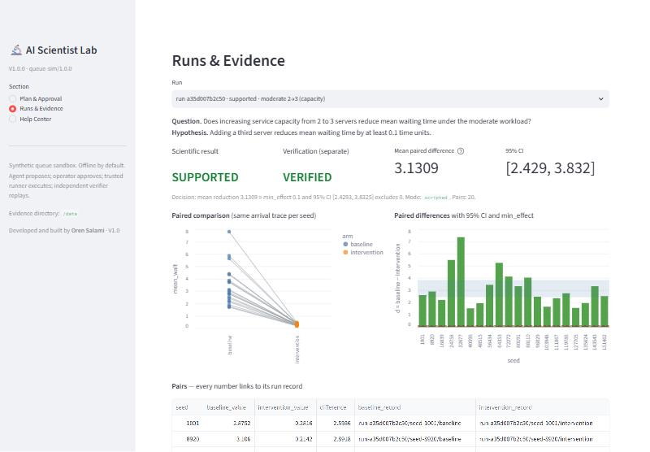

# AI Scientist Lab V1.0

A local research proof of concept: can a **bounded research agent** turn a question into a
**reproducible experimental conclusion**? It works in one synthetic, non-biological sandbox: a
seeded multi-server queue. The agent proposes a pre-registered plan. An operator approves the
exact plan. A trusted runner executes it, and an independent verifier replays it.

*Developed and built by Oren Salami · V1.0*



## Quick start (Windows PowerShell)

```powershell
docker compose up -d --build          # one command: builds and starts the app on http://127.0.0.1:8501
docker compose exec lab python -m scientist_lab demo --approve-as $env:USERNAME   # three seeded scenarios
docker compose exec lab python -m pytest -q                                       # test suite
```

Open <http://127.0.0.1:8501>. The port is published on localhost only. See
[docs/usage.md](docs/usage.md) for local (non-Docker) setup, the CLI and smoke checks.

## Workflow

| Step | Component | Guarantee |
|---|---|---|
| 1 Propose | `proposer.py` (scripted, optional Ollama) | Typed plan: hypothesis, workload, arms, metric, seeds, decision rule, all fixed before evaluation |
| 2 Validate | `policy.py` | Independent check of allowed parameters, the fixed tool catalog and budgets; rejections recorded with reasons |
| 3 Approve | `policy.approve` | Approval is bound to the plan's SHA-256 hash; any edit voids it |
| 4 Execute | `runner.py` | Only typed `queue.simulate` calls; no shell, code execution or external tools; rejected or unapproved plans make no call |
| 5 Verify | `verifier.py` | Replays every call, recomputes paired differences and the decision; reported separately from the result |
| Report | `report.py`, UI | Markdown report and JSON evidence bundle; every number cites its run record |

## Demonstrated outcomes (seeded, reproducible)

| Scenario | Comparison | Result | Verification |
|---|---|---|---|
| `capacity` | moderate load, 2 → 3 servers | **supported** (mean d = 3.1309, 95% CI [2.4293, 3.8325]) | verified |
| `sham` | moderate load, 2 → 2 servers + no-op relabel | **supported null**: all 20 paired differences exactly 0 | verified |
| `low_benefit` | light load, 2 → 3 servers | **contradicted** (mean d = 0.0797, CI upper 0.0949 < min_effect 0.1) | verified |

The Windows host and the Linux container produce identical numbers.

## Layout

```
src/scientist_lab/   schemas, simulator, catalog, policy, proposer, runner, analysis, verifier, store, report, cli
app/                 Streamlit UI (Plan & Approval, Runs & Evidence, Help Center)
tests/               pytest suite (simulator, policy, approval binding, replay, tampering, CLI)
docs/                methodology.md, usage.md, handoff.md, screenshots/
```

Runtime evidence goes to `data/` locally or the `lab-data` Docker volume. Both are kept out of Git.

## Scope and limits

This is a synthetic sandbox. Its results describe the simulator only. They say nothing about real
queues or systems. The project measures reproducibility and evidence quality in that setting. See
[docs/methodology.md](docs/methodology.md).

**Inspiration:** [Sakana AI — The AI Scientist](https://sakana.ai/ai-scientist/) for the research loop;
[ESCAPE LAB](https://github.com/Oren1984/escape-lab) for separating proposal from authorization;
[Agent Repair Lab](https://github.com/Oren1984/agent-repair-lab) for independent verification;
[Causal Universe: What If?](https://github.com/Oren1984/causal-universe-what-if) for matched simulation comparisons.
